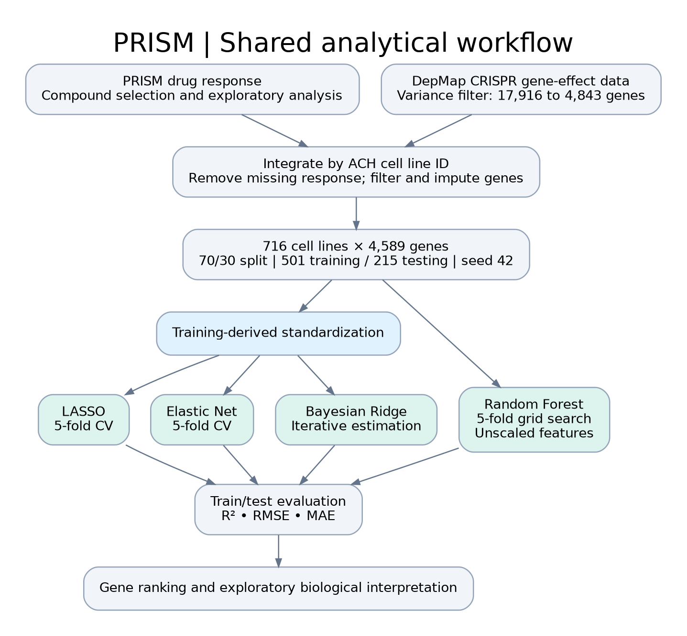
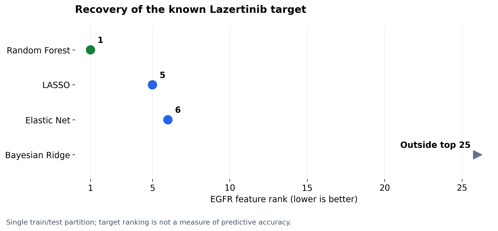
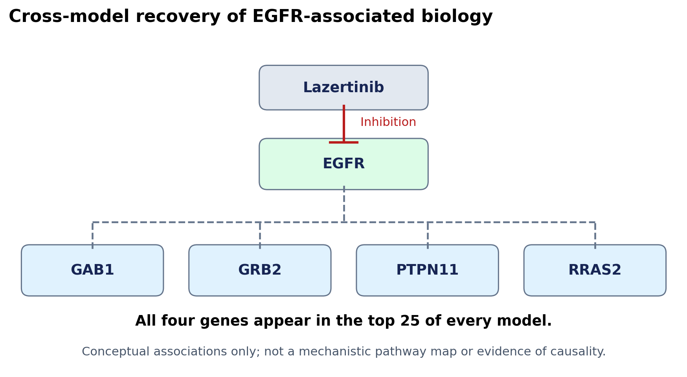
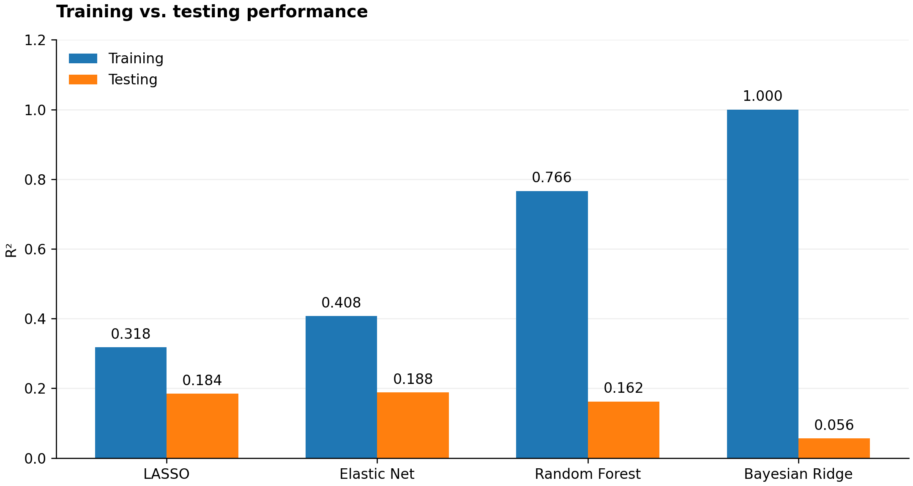
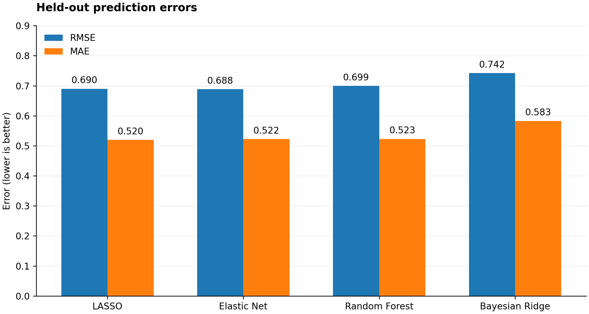

# PRISM-ML-Model-Comparison

Comparative analysis of LASSO, Elastic Net, Bayesian Ridge, and Random Forest regression using PRISM drug response and CRISPR gene-effect data to explore predictors of Lazertinib response in cancer cell lines.

## Methodology

### 1. Data acquisition

Data were obtained from the [DepMap Portal](https://depmap.org/portal/). The notebooks record a PRISM download date of June 26, 2025, and use the PRISM 24Q2 release. Input files:

- `Repurposing_Public_24Q2_Treatment_Meta_Data.csv`
- `Repurposing_Public_24Q2_Extended_Primary_Data_Matrix.csv`
- `Repurposing_Public_24Q2_Extended_Primary_Compound_List.csv`
- `Model.csv`
- `CRISPRGeneEffect.csv`

### 2. Compound selection and exploratory analysis

Compound annotations were joined to PRISM response measurements using compound identifiers. Candidate oncology compounds were identified using drug-name keyword matching and ranked by nonmissing cell line coverage. Four compounds were shortlisted: Imatinib, Ripretinib, Lazertinib, and Trilaciclib. Drug response distributions and cell line lineage representation were explored. Lazertinib was selected for modeling.

### 3. Data integration and quality control

- Calculate gene-effect variance across the original CRISPR dataset. Remove genes with variance below 0.02 (13,073 of 17,916 genes), retaining 4,843 genes.
- Exclude cell lines without Lazertinib response measurements and inner-join the response and filtered CRISPR datasets using ACH cell line identifiers.
- Remove genes with more than 10 missing observations.
- Impute remaining missing gene-effect values using the mean of each gene column.
- Verify dataset dimensions and missing-value counts.

CRISPR gene-effect scores are the predictive features; the original continuous PRISM Lazertinib response is the target. Cell line metadata support exploratory analysis rather than serving as model features.

### 4. Dataset partitioning

All four notebooks use a 70/30 random train/test split (`random_state=42`).

| Dataset | Cell lines | Gene features |
|---|---:|---:|
| Complete | 716 | 4,589 |
| Training | 501 | 4,589 |
| Testing | 215 | 4,589 |

For the three linear models, `StandardScaler` is fitted on training features and applied to testing features. Random Forest uses unscaled features. The response is not standardized or binned.

### 5. Model training

| Model | Implementation | Optimization |
|---|---|---|
| LASSO | `LassoCV` | Five-fold CV for regularization strength |
| Elastic Net | `ElasticNetCV` | Five-fold CV for alpha and L1 ratio |
| Bayesian Ridge | `BayesianRidge` | Iterative estimation; no explicit CV search |
| Random Forest | `RandomForestRegressor` | 200 trees; five-fold grid search over depth, leaf size and feature sampling |

### 6. Model evaluation and gene ranking

Training and testing predictions are evaluated using R², root mean squared error (RMSE), and mean absolute error (MAE). LASSO and Elastic Net genes are ranked by absolute nonzero coefficients, Bayesian Ridge genes by absolute coefficient magnitude, and Random Forest genes by feature importance. Rankings are exploratory associations, not evidence of causal drug-response mechanisms.

### 7. Limitations

This is an exploratory model comparison, not a definitive benchmark or clinical validation. Variance filtering and mean imputation occur before the train/test split, and scaling for the linear models occurs before internal cross-validation. Future work should fit preprocessing within training and cross-validation folds to reduce potential information leakage. Model tuning differs across methods. Independent validation and repeated splits would help assess robustness. The release versions of the two non-PRISM DepMap files are not explicitly established here.

Some notebook narrative comments refer to an earlier classification-based Random Forest analysis; the current comparison uses continuous regression for all four models.

## Results and biological interpretation

Lazertinib, a third-generation EGFR tyrosine kinase inhibitor, was selected to investigate whether machine learning models trained on CRISPR gene dependency profiles could recover its known molecular target and associated signaling biology.

### Comparative gene ranking

| Gene | Random Forest | LASSO | Elastic Net | Bayesian Ridge |
|---|---:|---:|---:|---:|
| **EGFR** | **1** | **5** | **6** | — |
| GAB1 | 3 | 8 | 7 | 1 |
| PTPN11 | 5 | 2 | 2 | 4 |
| GRB2 | 4 | 10 | 4 | 9 |
| RRAS2 | 16 | 6 | 8 | 5 |
| TP63 | 2 | 1 | 3 | — |
| NOTCH2 | — | 4 | 1 | 2 |
| ERBB2 | 7 | — | — | — |
| ERBB3 | 12 | — | — | — |
| BRAF | 20 | — | — | — |

*Ranks are based on model-specific feature importance or absolute coefficient magnitude. A dash indicates a gene outside the top 25.*

| Model | EGFR rank | Biological interpretation |
|---|---:|---|
| Random Forest | 1 | Direct molecular target ranked first |
| LASSO | 5 | Direct target and associated signaling genes recovered |
| Elastic Net | 6 | Direct target and associated signaling genes recovered |
| Bayesian Ridge | Outside top 25 | Associated signaling genes recovered |

### Cross-model convergence

All four models identified GAB1, PTPN11, GRB2, and RRAS2 among their top 25 features. This convergence suggests that CRISPR gene dependency profiles may capture biologically informative signatures associated with Lazertinib sensitivity.

## Conclusion

Random Forest demonstrated the strongest direct target prioritization in this analysis, ranking EGFR as its most important predictive feature. LASSO and Elastic Net also recovered EGFR among their highest-ranked genes, while Bayesian Ridge prioritized several associated signaling components without ranking EGFR among its top 25 features.

These findings illustrate the potential of complementary machine learning approaches to recover known drug-target biology from high-dimensional CRISPR dependency data. Cross-model convergence may provide a useful exploratory strategy for identifying biologically relevant predictive features.

### Future directions and limitations

These findings represent a single experimental configuration using one compound and one train/test partition. Additional random seeds, repeated validation, independent datasets, and additional compounds with established mechanisms of action are needed to assess generalizability. Future analyses should also address the preprocessing limitations described in the methodology.

Feature rankings are not evidence of causality. Direct target recovery does not necessarily indicate superior overall predictive performance, and these models are not independent biological validations because they share the same underlying data.

## Comparative Model Performance

All four regression models were evaluated using the same reported training and testing partition. Performance was assessed using the coefficient of determination (R²), root mean squared error (RMSE), and mean absolute error (MAE).

| Model | Training R² | Training RMSE | Training MAE | Testing R² | Testing RMSE | Testing MAE | EGFR rank |
|---|---:|---:|---:|---:|---:|---:|---:|
| LASSO | 0.318 | 0.600 | 0.439 | 0.184 | 0.690 | **0.520** | 5 |
| Elastic Net | 0.408 | 0.559 | 0.413 | **0.188** | **0.688** | 0.522 | 6 |
| Random Forest | 0.766 | 0.351 | 0.230 | 0.162 | 0.699 | 0.523 | **1** |
| Bayesian Ridge | 1.000 | 3.51 × 10⁻⁶ | 2.60 × 10⁻⁶ | 0.056 | 0.742 | 0.583 | Outside top 25 |

Bold values indicate the best observed held-out metric or direct target rank. Values are rounded from the saved model outputs.

**Metric Interpretation Key:**

- **R² (Coefficient of Determination):** Higher is better.
  Ideal = 1.0; 0 indicates baseline performance;
  negative values indicate worse-than-baseline performance.
- **RMSE (Root Mean Squared Error):** Lower is better.
  Ideal = 0. Penalizes larger prediction errors.
- **MAE (Mean Absolute Error):** Lower is better.
  Ideal = 0. Represents the average absolute prediction error.
- **EGFR Rank:** Lower is better. Ideal = 1, indicating
  EGFR is the highest-ranked predictive feature.
- **Training vs. Testing:** Smaller performance gaps are
  generally preferred. Strong training performance combined
  with weak testing performance may indicate overfitting.

### Training and Testing Performance

LASSO and Elastic Net exhibited similar held-out performance. Elastic Net achieved the highest testing R² (0.188), while LASSO exhibited the smallest training-to-testing R² gap. Random Forest achieved higher training R² but lower testing R² than either regularized linear model. Bayesian Ridge achieved nearly perfect training fit but substantially weaker testing performance, consistent with pronounced overfitting.

### Held-out Prediction Error

Elastic Net achieved the lowest testing RMSE, while LASSO achieved the lowest testing MAE. The differences among LASSO, Elastic Net, and Random Forest were small. Bayesian Ridge exhibited the highest testing errors. Overall, held-out R² values indicate modest predictive performance across all four models.

### Predictive Performance vs. Biological Target Recovery

Random Forest ranked EGFR, the known molecular target of Lazertinib, first among its predictive features. LASSO and Elastic Net ranked EGFR fifth and sixth, respectively. Bayesian Ridge did not rank EGFR among its top 25 features. All four models nevertheless prioritized GAB1, PTPN11, GRB2, and RRAS2 among their top 25 features.

These observations illustrate that predictive generalization and recovery of known drug-target biology are distinct evaluation objectives. Random Forest achieved the strongest direct target prioritization in this experiment despite lower held-out predictive performance than LASSO and Elastic Net.

### Limitations

These results represent one compound and one train/test partition. Differences in model performance are descriptive, not evidence of statistically significant superiority. Preprocessing and tuning differences may affect comparisons; future work should fit preprocessing within training and cross-validation folds, evaluate repeated splits, and validate results on independent datasets and additional compounds. Feature rankings are model-specific associations and do not establish causality.

